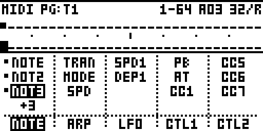
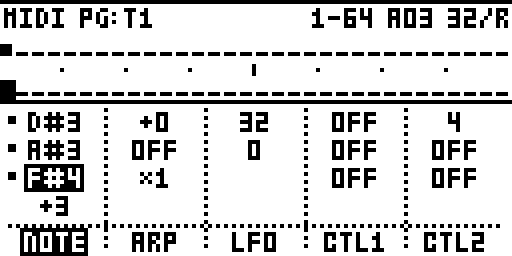
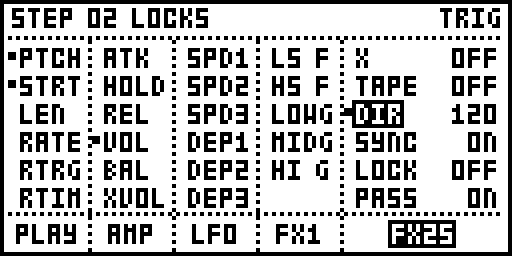
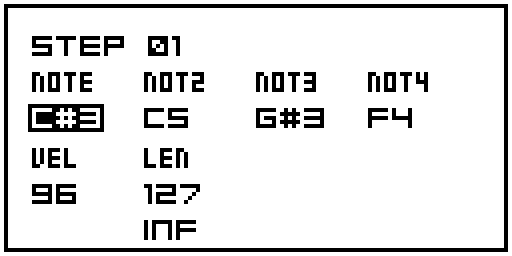

# STEP VIEW

**See and edit the Octatrack's sequences on its screen.**

On a stock Octatrack, a pattern lives in the 16 trig LEDs and in parameter-lock menus. You see one track
and one page at a time, a note is a number you dial in, and a step's p-locks stay hidden until you hold
its trig and look through each page in turn.

STEP VIEW draws the sequences on the screen: all 8 tracks at once, a whole 64-step track, a piano
roll of the notes, or every p-lock on a step. You edit them right there. It works on both sides of the
Octatrack, the 8 **audio** tracks and the 8 **MIDI** tracks, and **MIDI** switches between them.

It's a module for [octabam](https://github.com/sambanks/octabam), a toolkit for building your own
Octatrack OS (1.40C, MKI and MKII).

---

## Contents

- [Quick start](#quick-start)
- [Audio and MIDI](#audio-and-midi)
- [The four views](#the-four-views)
  - [1. Tracks](#1-tracks-the-whole-pattern)
  - [2. Pages](#2-pages-one-track-all-64-steps)
  - [3. Pitch](#3-pitch-a-piano-roll-midi)
  - [4. Split](#4-split-the-numbers-for-the-arranger)
- [The lock window](#the-lock-window): every p-lock on a step
  - [The note window (MIDI)](#the-note-window-midi)
- [Encoder D](#encoder-d-press-it-to-change-how-the-view-looks)
- [Everything else](#everything-else) (editing, copy / paste, track names)
- [Settings](#settings-brain--settings--step-view)
- [Why it works this way](#why-it-works-this-way)
- [Adding it to your build](#adding-it-to-your-build)

---

## Quick start

| Action | Result |
|---|---|
| Hold **MIXER**, press **MIDI** | STEP VIEW opens, from any page. |
| Press **MIXER + MIDI** again | The next view: **Tracks → Pages → Pitch → Split →** back to Tracks. |
| Press **MIDI** alone | Switch between the 8 audio tracks and the 8 MIDI tracks. |
| **Arrows** | Move the cursor. |
| **YES** | Open the step's [lock window](#the-lock-window): every p-lock on it. On an empty MIDI step: a note, and the [note window](#the-note-window-midi). On an empty audio step: a trig. |
| **FUNC + PLAY** | Clear the step. |
| **FUNC + NO** | Undo. **FUNC + YES** redoes. |
| Press **encoder D** | Zoom in or out (Tracks, Pages, Split's timeline), or switch the piano-roll layout (Pitch). |
| **NO** | Back out: closes whatever is open, and from the grid, leaves STEP VIEW. |

---

## Audio and MIDI

STEP VIEW shows one side at a time: the 8 audio tracks (**AUDIO** in the title) or the 8 MIDI tracks
(**MIDI** in the title). Press **MIDI** alone, without MIXER, to switch. Everything works on both sides
except Pitch, which is for notes and so MIDI only.

| | Audio tracks | MIDI tracks |
|---|---|---|
| **Tracks, Pages, Split** | ✓ | ✓ |
| **Pitch** (piano roll) | | ✓ |
| **Lock window** columns | PLAY AMP LFO FX1 FX2 | NOTE ARP LFO CTL1 CTL2 |

Showing the audio tracks puts the Octatrack itself in audio mode, so the hardware works on the audio
track under the cursor as it normally would: the trig keys and their LEDs in grid recording, FUNC +
BANK's track settings, and holding a trig to lock a value with the knobs. Leaving STEP VIEW from the audio
tracks keeps the Octatrack in audio mode. Leaving from the MIDI tracks takes you back to the page you
were on, in the mode you were in.

---

## The four views

| View | What it shows | Use it for |
|---|---|---|
| **Tracks** | All 8 tracks at once, one row each. | Placing trigs fast and seeing the whole pattern. |
| **Pages** | One track's 64 steps, its four pages stacked. With the arranger on, the arrangement in the order it plays. | Long tracks, and following an arrangement. |
| **Pitch** | One MIDI track as a piano roll. | Writing melodies and bass lines. |
| **Split** | The grid on the right, the cursor step's values and the pattern cues on the left. | Exact values, and running the arranger. |

### 1. Tracks: the whole pattern

All 8 tracks, one row each. Use it to place trigs quickly and see what every track is doing.


*The 8 MIDI tracks, 32 steps a row (the default), each a different length.*


*The 8 audio tracks: AUDIO in the title.*

How to read it:

- **Tall bar** = a trig. **Short bar** = a trigless trig. **Line** = an empty step.
- Each row shows **only that track's own steps**, and **its length** is at the right end of the row.
  Tracks can be different lengths (SCALE set to PER TRACK); the rest of a shorter track's row is blank.
- **Each row follows its own track.** While playing, a row shows the part of its track that's
  playing, with the play mark at that track's own step, so a short track never scrolls out of view.
  The cursor's row shows the cursor's page while you move it, and the page boxes follow the cursor's
  track.
- The track number at the left is **inverted** for the active track and flashes **M** when the track
  is muted.
- **The title**: MIDI: or AUDIO: and the track's name at the left. At the right: the arrangement row
  (R00, with the arranger on), the pattern playing (A03), and four boxes for the pattern's four pages,
  the ones on screen filled.
- **A pattern coming up** shows as **A03>>A04**. In time with the tempo, the >> swaps for the number of
  bars left, inverted (A03 **3** A04), counting down to the change; "--" while stopped.


*16 steps a row: press encoder D. Track 1 is 16 steps, track 2 is 12, track 3 is 8, down to track 7 at
3; track 8 is 64, so it carries on over the next pages.*


*Playing: each row's play mark sits at its own track's step. The 64-step track has moved on, while the
short tracks keep looping in place.*

A pattern coming up shows as A03>>A04, with the bars left swapping in for the >> on the flash.

**Whole tracks.** Press LEFT on step 1 and the cursor moves onto the track number, which flashes.
There, **FUNC + REC** copies the whole track (all 64 steps, their locks, the length and scale),
**FUNC + STOP** pastes it onto the track you're on, and **FUNC + PLAY** clears all its steps.
**UP / DOWN** move between track numbers, and **RIGHT** goes back to step 1. **FUNC + NO** undoes. On
the audio side, CLEAR only.


*The cursor on track 1's number (it flashes), ready to copy, clear or paste the whole track.*

### 2. Pages: one track, all 64 steps

The cursor's track, its four pages stacked. Use it to see a whole long track at once.

**Arranger off: the steps, with the step's parameters underneath.** The top half shows the track's
steps, the bottom half the cursor step's parameters in the [lock window's](#the-lock-window) five
columns, on both sides.


*Audio track 1, step 33: PTCH and STRT locked on PLAY, VOL on AMP (the dots). The cursor is in the
panel, editing STRT (its value, SL1, shown).*


*Hold FUNC: the values. A locked parameter shows its lock, the others the Part's value.*


*MIDI track 1, step 33: a chord. NOTE, NOT2 and NOT3 (locked: the dots), and three more (+3).*


*Hold FUNC: the same, by value. NOT2-4 show as the notes they play.*

- Each column always shows its most-used parameters, plus any others locked on the step:
  - MIDI: NOTE VEL LEN, TRAN MODE SPD, SPD1 DEP1, PB AT CC1, CC5 CC6 CC7.
  - Audio: the first three on PLAY, ATK HOLD VOL, SPD1 DEP1, and the first two of each effect.
- A **dot** marks a locked parameter. The rest show the Part's value (with FUNC held).
- A column has four lines. When there are more, the fourth says how many (**+3**); the lock window
  shows them all.
- **DOWN** past the grid's last row moves the cursor into the panel. There it works like the lock
  window: the arrows or the page keys pick a lock, **YES** edits it (its value shows, **LEVEL** changes
  it; on MIDI's NOTE column YES opens the note window), and **UP** off the first line goes back to the
  grid.
- **Knobs** do nothing here, so nothing gets locked by accident. On the audio side, holding a trig and
  turning a knob still locks that trig's step, as on the stock Octatrack.
- Press **encoder D** to switch between 16 and 32 steps a row.
- Leave the view with NO or MIXER + MIDI.

**Arranger on: the timeline.** Pages becomes your arrangement, laid out in the order it plays, one page
per row, for the cursor's track.


*Four arrangement rows, 32 steps a row: A03, A02 twice, A04, A03. Every row's steps for the cursor's
track, in the order they'll play, without opening a single pattern.*


*16 steps a row (press encoder D). Each inverted line is a row's settings: R01 (row 1), A02 (its
pattern), X2 (played twice), 0016 (offset 0, length 16 steps), S-/- (no scenes). Under it, that row's
steps.*

Each arrangement row starts with a line of its settings: row number, pattern, repetitions, offset and
length, scenes, mute. You can change them right there: **LEFT / RIGHT** pick one, **LEVEL** changes it.
A countdown shows the bars left before the next row.

### 3. Pitch: a piano roll (MIDI)

The cursor's MIDI track as notes on a keyboard, for writing melodies and bass lines. **Press encoder D**
to switch between three layouts. They all show the same notes and keep the same range. The arranger
doesn't change this view.


*ROLL 16: one page of 16 steps, a keyboard on the left. Press encoder D for the next layout.*


*ROLL 32: two pages across two octaves.*


*KEYS 16: turned sideways, steps run down the screen over a keyboard, like a player piano's roll
feeding into the keys.*

How to read it:

- **Squares** are notes, and the box is the cursor.
- A small arrow means a note that's **above or below** what's on screen. It sits on the row with the
  same letter, or on the top or bottom row when that letter has no row on screen.
- Dotted rows are the sharps.
- The title shows the cursor's note (C3), the pattern, and which of the four pages you're on.

Moving around:

- **Up and down in pitch**: the arrows along the keyboard, or **knob A** (in ROLL 32: **LEVEL**). Go
  past the edge and the range scrolls.
- **FUNC +** those moves by an octave.
- **Along the steps**: the other two arrows, or **LEVEL** (in ROLL 32: **knob A**).
- **To another page**: FUNC + those arrows, or the **SCALE / PAGE** key.
- **To the lowest / highest note on the page** (ROLL 16): press **encoder A / C**.

**The trig keys become a keyboard** in this view:

- The 16 trig keys play 16 notes in a row, starting from C. Their LEDs light the white keys; in ROLL
  16 and ROLL 32 they also show the cursor's note and, while playing, the note playing. KEYS 16 keeps
  them still.
- Press one to hear it. **FUNC + a trig key** writes that note into the cursor's step.
- **Knob E** slides the keyboard up and down a semitone, and **FUNC + knob E** an octave.
- **PATTERN + trig** and **BANK + trig** still pick patterns and banks as usual.

### 4. Split: the numbers, for the arranger

The screen split in two: the grid on the right, and on the left a column with the cursor step's trig, the
pattern cues (the pattern playing and the one coming, beside the grid) and the play clock at the bottom.
It was designed as the arranger's companion, and follows it: turn the arranger on or off and Split
switches with it.

- **Arranger off**: the 8 tracks.
- **Arranger on**: the timeline, plus the arrangement controls. You can see and change the row
  playing and the pattern of this row and the next, and mute the row. Each pattern's cue sits on the
  left at the row where it starts. Save the arrangement from the ARR menu.

The left column's top line shows the cursor step's trig (TRIG, TRIGLESS or NO TRIG), on both sides.
**YES** on a step opens its [lock window](#the-lock-window), which also shows the step's number.


*MIDI track 1, the cursor on a step with a trig. A03 is playing and repeats (∞).*


*The same on the audio tracks.*


*An arrangement: ROW 00 is the row the arranger is on, M A03 its mute and pattern. A04 and A03 further
down mark where later rows start, beside the timeline.*

**The left column's lines (MIDI).** Press an arrow past the edge of the grid's page and the cursor moves
into the left column, onto the nearest value: the track's name (in the grid's title) with the arranger
off; with it on, this row's pattern line or the next one's, whichever is closer to the cursor's row.
**UP / DOWN** pick a line, **LEFT / RIGHT** move along it, and **LEVEL** changes it. **RIGHT** past the end of a line, or **NO**, goes back to the grid.

**Zoomed timeline.** With the arranger on, press **encoder D** to show 4, 8 or 16 steps a row. **UP /
DOWN** move one row at a time.

---

## The lock window

Every parameter on a step, on one screen, with its lock or its value. Open it with **YES** on a step:

- **Audio tracks**: YES on a step with a trig or p-locks, in any view. YES on an empty step just puts a
  trig there.
- **MIDI tracks**: YES on a step with a note, in any view. (YES on an empty step puts a note there and
  opens the [note window](#the-note-window-midi).)


*Audio track 1, step 2: PTCH and STRT locked on PLAY, VOL on AMP (the dots). AMP is picked, so it's
wide, with its values; VOL is the cursor.*


*Hold FUNC: the narrow columns show their values too.*


*MIDI track 1, step 1: a chord. NOTE and NOT2-4 sit together, each shown as the note it plays (C#3,
C5, G#3, F4), then VEL and LEN.*

There's one column for each page key, in the order the keys sit under the screen:

| | Key 1 | Key 2 | Key 3 | Key 4 | Key 5 |
|---|---|---|---|---|---|
| **Audio tracks** | PLAY (SRC on the MKII) | AMP | LFO | FX1 | FX2 |
| **MIDI tracks** | NOTE | ARP | LFO | CTL1 | CTL2 |

How to read it:

- **Every parameter** of each page is listed, locked or not, so you always know where to find one.
- **The picked column is wide**: names on the left, values on the right. The other four show names.
- **A dot** marks a parameter locked on this step. Its value is the lock; the others show the
  Part's value, which is what the step plays.
- **MIDI's NOTE column** lists NOTE, NOT2, NOT3 and NOT4 together, then VEL and LEN. NOT2-4 show as
  the notes they play (NOTE plus the offset), "-" when off.
- **ARP** is shown for reference; the Octatrack can't lock it.
- **The page key's LED** follows the picked column.

| Action | Result |
|---|---|
| A **page key**, or **LEFT / RIGHT** | Pick a column. |
| **UP / DOWN** | Pick a parameter in the column. |
| **YES** | Edit it: its value inverts, and **LEVEL** changes it (an unlocked one gets locked, starting from the Part's value). YES again or NO ends the edit. On a MIDI step's NOTE column, YES opens the [note window](#the-note-window-midi) instead. |
| **FUNC + YES** | Switch the step between TRIG and TRIGLESS. Its locks stay. |
| Hold **FUNC** | The narrow columns show values too. |
| Press a **knob** | Remove that parameter's lock. |
| **Knobs A-F** (turned) | Nothing, so nothing gets locked by accident. |
| **NO** | Close the window. |

**FX SETUP locks (audio, with PLOCKS P2).** With octabam's PLOCKS P2 module in your build (see
[Adding it to your build](#adding-it-to-your-build)), **FUNC + FX1** or **FUNC + FX2** turns that column
into the effect's SETUP page (FX1S / FX2S at the foot). It works like the main page: the dot, the
Part's value, YES and LEVEL to lock. FUNC + the key again goes back.


*FUNC + FX2: the delay's SETUP page. DIR locked to 120 on this step.*

The same columns, four lines tall, are the bottom half of [Pages](#2-pages-one-track-all-64-steps).

### The note window (MIDI)


*One MIDI step's notes, big: NOTE and NOT2-4 by name and octave, VEL, and LEN with its subdivision.*

It opens when you add a note (YES on an empty MIDI step), or with YES on the lock window's NOTE column.
The arrows pick a value and **LEVEL** changes it. **NO** goes back to the lock window (or to Pages'
panel, if you came from there).

---

## Encoder D: press it to change how the view looks

Press **encoder D** in any view to change how it's shown. In Pages, turning D sets the row spacing (10 to
start, with the arranger on; with it off the knobs lock values).

While STEP VIEW is open, a knob it doesn't use does nothing, turned or pressed. The page under the view
(AMP on the audio side, the ARP page on MIDI) can't be changed unseen. With a trig key held, the knobs
lock values on that step as usual.

| View | Press D |
|---|---|
| **Tracks** | Zoom: 16 ↔ 32 steps a row |
| **Pages** | Zoom: 16 ↔ 32 steps a row |
| **Pitch** | Next layout: ROLL 16 → ROLL 32 → KEYS 16 |
| **Split** (arranger on) | Zoom the timeline: 4 → 8 → 16 steps a row |

---

## Everything else

### Editing steps

- **Track keys** jump the cursor to that track. **UP / DOWN** in Tracks also make that track the
  active one.
- **UP / DOWN** move one row and keep the cursor at the same spot on the screen, in every view and
  zoom: in Tracks, to the next track's step in the same column; in Pages, to the same column a row
  up or down (no wrapping; DOWN past the last row goes into the lock panel).
- **SCALE / PAGE** jumps a page, as does **FUNC + LEFT / RIGHT**. **LEVEL** in the grid moves the cursor
  along the 64 steps.
- **Undo** goes back nine steps, for the whole pattern.
- **MIDI notes** have four voices (NOTE and NOT2–4), a velocity and a length. They're all locked to the
  step, so each step can be different.
- **Grid recording** (MIDI): hold a trig key for a moment to open that step's lock window. Turn
  **LEVEL** with the key held to change its note.

### Copy, clear, paste

In STEP VIEW, **FUNC + REC / PLAY / STOP** are **COPY / CLEAR / PASTE**:

- **FUNC + LEVEL** marks a run of steps from the cursor. COPY, CLEAR or PASTE then work on that run.
  PASTE repeats what you copied to fill the run.
- On a **track number** (Tracks): COPY, CLEAR and PASTE act on the whole track, length and scale
  included. On the audio side, CLEAR only.
- With nothing marked: **COPY** copies the cursor's step, **CLEAR** clears it, and **PASTE** puts the
  copy at the cursor.
- **Copying between audio and MIDI tracks** (grid recording's FUNC + REC / FUNC + STOP) converts
  between them. An audio track's pitch becomes notes, and an OCTA-303 line keeps its accents and
  slides.

### Track names (MIDI)

Each MIDI track can have a 12-character name, per Part and bank. It shows in the grid's title in place
of T1-T8. To set it in Split (arranger off), press LEFT at the grid's first step: the cursor lands on
the name. Hold **FUNC** for a
keyboard of characters. Names are saved with the project.

---

## Settings (BRAIN > SETTINGS > STEP VIEW)

octabam keeps module settings in its **BRAIN** menu. STEP VIEW's are **project settings**: each
project saves its own copy when you SAVE PROJECT and gets it back when you load it. STEP VIEW writes
them itself as you use it, so you never need to touch them. They're there so a project opens the way
you left it, and so you can see or reset them.

| Setting | What it means |
|---|---|
| **FULL** | Which kind of view you were in: 1 = Tracks, Pages or Pitch; 0 = Split. |
| **PAGES** | 0 = Tracks, 1 = Pages. (The Split view ignores this and follows the arranger.) |
| **PITCH** | 1 = you were in the Pitch view. |
| **LAYOUT** | The Pitch layout: ROLL 16, ROLL 32 or KEYS 16. |
| **RANGE** | The lowest note the Pitch view shows (45 = A2). The view shows two octaves from here. |
| **ROW** | Where the Pitch cursor is, in semitones above RANGE. |
| **ROLL16 BASE** | ROLL 16 shows 11 of those notes at a time; this is which one is at the bottom. |
| **TRIG ROOT** | The lowest note of the trig-key keyboard. -1 = start from the C below the cursor. |
| **FULL ZOOM** | Steps per row in Tracks and Pages: 2 = 16, 3 = 32. |
| **ZOOM** | Steps per row in the Split view's timeline: 0 = 4, 1 = 8, 2 = 16. |

MIXER + MIDI always opens Tracks, Pages or Pitch, whichever you used last. The Split view is one press
of the combo further on.

---

## Why it works this way

These choices are the current answers, not final ones. Here's the thinking, so you can disagree with
it.

- **MIXER + MIDI to get in.** The Octatrack has no spare page key. STEP VIEW draws on top of the MIDI
  ARP page but only while it's open, so the arpeggiator stays fully usable. MIXER + MIDI works from
  any page and doesn't take a key away from anything.
- **The same combo to switch views.** One gesture to remember. The cost is that the Split view is
  four presses away.
- **MIDI alone for the other side.** It's the key that already switches the Octatrack between its audio
  and MIDI tracks, so in STEP VIEW it does the same thing.
- **NO to go back.** Everywhere else on the Octatrack NO means "back" or "cancel", so it does here
  too: it closes what's open, and from the grid it leaves.
- **FUNC + PLAY to clear.** That's the Octatrack's own CLEAR combo. Undo (FUNC + NO) is there if you
  clear the wrong thing.
- **Press D to change the view.** One action does the same kind of thing everywhere: zoom in Tracks,
  Pages and the timeline, the layout in Pitch.
- **The track number for whole-track actions.** The number is already the track's label, so putting
  the cursor on it means "this whole track", the same way the cursor on a step means "this step".
- **The lock window's columns follow the page keys.** The five keys under the screen already mean
  those five pages, so pressing one jumps to its column, and each column's name sits above its key.
  Every parameter is listed, so it's always in the same place; the column you're in widens to show
  values, and FUNC, the Octatrack's "show me more" key, shows the rest. Pages uses the same columns,
  four lines tall, so it shows the most-used parameters and the locks.
- **The Split view for the arranger.** The arranger is the part of the Octatrack that's hardest to
  see. The Split view puts the arrangement's timeline next to the numbers you need to edit it.
- **Nothing outside STEP VIEW changes**, apart from these:
  - **MIXER** opens its window when you let go, not when you press it, so that MIXER + MIDI can work.
  - **FUNC + BANK** twice with the arranger on opens the arrangement editor.
  - In the stock SCALE window (FUNC + SCALE / PAGE), **UP / DOWN** move between rows and **SCALE**
    opens ALL TRACK SCALES.
  - Copying a track in grid recording can convert between audio and MIDI tracks.

---

## Adding it to your build

You need octabam's build, which uses your own copy of the Octatrack OS (no Elektron code is in this
repo). STEP VIEW needs two other octabam modules: **BRAIN** (settings) and **STORE** (track names).

1. Copy `modules/step-view` into an octabam checkout's `modules/` folder.
2. Add `"STEP VIEW"` to your remix's `modules=(...)`, after `"BRAIN"` and `"STORE"`.
3. In `modules/store/manifest.py`, add this line to `CLIENTS`:
   ```python
   ("STEP VIEW", "sgn", ("loadall_pre", "loadmask_pre", "newproj", "bankw_post", "pstore_pre",
                         "pstore_post", "preload_post", "partclear")),
   ```
4. Run `make modules` to check it doesn't clash with your other modules, then
   `make bus REMIX=<yours>`.

If you also use octabam's TRIG MODES module, STEP VIEW keeps the active track's trig mode in step
with it.

**FX SETUP locks** need octabam's **PLOCKS P2** module (with SCENES P2 and EVENTS, which it requires)
and two small routines added to it, so STEP VIEW can read and write its locks. From your octabam
checkout:

```sh
git apply modules/step-view/plocks-p2-step-view.patch
```

Without them, the lock window works the same, and FUNC + FX1 / FX2 just picks the column.

| File | What it is |
|---|---|
| `modules/step-view/stepview.s` | The code (ColdFire assembly, runs from RAM). |
| `modules/step-view/manifest.py` | Tells octabam where it hooks in, and its settings. |
| `modules/step-view/brain.lock` | The settings' fixed IDs. |
| `modules/step-view/UI_RULES.md` | The layout rules the screens follow (centring, spacing). |
| `modules/step-view/plocks-p2-step-view.patch` | The two routines PLOCKS P2 needs for FX SETUP locks. |
| `docs/screens/` | The screenshots on this page, from octabam's Octatrack emulator. |

**Status:** built and tested in octabam's emulator, in its author's own build and in octabam's
own `octabam` remix. Most of it runs on its author's MKI; the newest parts (the lock window's
layout and FX SETUP locks) are so far tested only in the emulator. Back up your card before flashing
anything.

## Licence and credit

MIT (see `LICENSE`): use it, change it and share it, keeping the notice. Written by Slingdinger. It
builds inside [octabam](https://github.com/sambanks/octabam) by Sam Banks and contributors, which has
its own terms.
