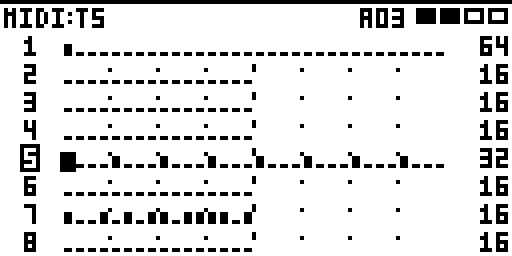
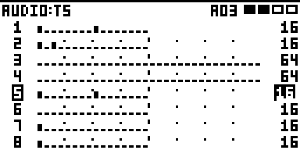
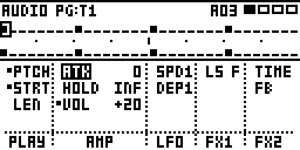
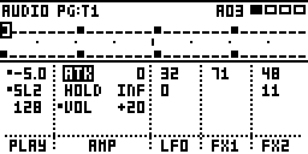
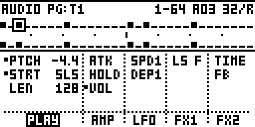
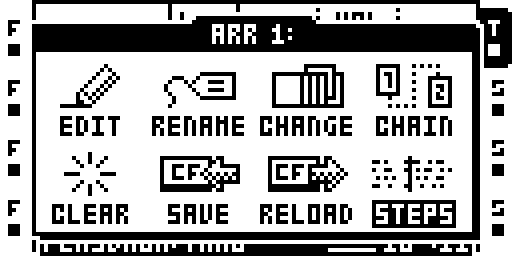
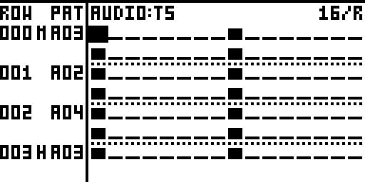
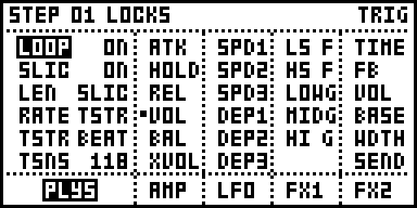

# STEP VIEW

**See and edit the Octatrack's sequences on its screen.**

On a stock Octatrack, a pattern lives in the 16 trig LEDs and in parameter-lock menus. You see one track
and one page at a time, a note is a number you dial in, and a step's p-locks stay hidden until you hold
its trig and look through each page in turn.

STEP VIEW draws the sequences on the screen and lets you edit them there:

- all 8 tracks at once, or one track's 64 steps,
- a piano roll of a MIDI track's notes,
- the arrangement as a timeline of steps,
- and every p-lock on a step, on one screen.

It works on both sides of the Octatrack, the 8 **audio** tracks and the 8 **MIDI** tracks.

It's a module for [octabam](https://github.com/sambanks/octabam), a toolkit for building your own
Octatrack OS (1.40C, MKI and MKII).



---

## Contents

- [Quick start](#quick-start)
- [Audio and MIDI](#audio-and-midi)
- [The four views](#the-four-views)
  - [1. Tracks](#1-tracks-the-whole-pattern)
  - [2. Pages](#2-pages-one-track-all-64-steps)
  - [3. Pitch](#3-pitch-a-piano-roll-midi)
  - [4. STEPS](#4-steps-the-arrangement)
- [The lock window](#the-lock-window): every p-lock on a step
  - [SETUP pages](#setup-pages)
  - [The note window (MIDI)](#the-note-window-midi)
- [Editing](#editing): moving, copy / clear / paste, track lengths, undo
- [Encoder D](#encoder-d)
- [Settings](#settings-brain--settings--step-view)
- [Why it works this way](#why-it-works-this-way)
- [Adding it to your build](#adding-it-to-your-build)

---

## Quick start

| Do this | What happens |
|---|---|
| Hold **MIXER**, press **MIDI** | STEP VIEW opens on the active track: the audio tracks in audio mode, the MIDI tracks in MIDI mode. |
| **MIXER + MIDI** again | Tracks ↔ Pages. |
| **MIDI** alone | The other side: audio ↔ MIDI tracks. |
| A MIDI **track key twice** (MIDI mode, any page) | **Pitch**, the piano roll, on that track. |
| **FUNC + BANK**, arranger on, then **STEPS** | **STEPS**, the arrangement as steps. |
| **Arrows** | Move the cursor. |
| **YES** on a step | Its p-locks ([lock window](#the-lock-window)). An empty step gets a trig (audio) or a note (MIDI). |
| **LEVEL** on a picked p-lock | Change it. It's locked on the step from the first turn. |
| **FUNC + REC / PLAY / STOP** | Copy / clear / paste. |
| **FUNC + NO**, **FUNC + YES** | Undo, redo. |
| Press **encoder D** | Zoom, or Pitch's next layout. |
| **NO** | Back: closes what's open, and from the grid leaves STEP VIEW. |

Leaving puts you back on the page you were on.

---

## Audio and MIDI

STEP VIEW shows one side at a time: **AUDIO** or **MIDI** in the title. Press **MIDI** alone to switch.

| | Audio tracks | MIDI tracks |
|---|---|---|
| Tracks, Pages, STEPS | ✓ | ✓ |
| Pitch | | ✓ |
| Lock window columns | PLAY AMP LFO FX1 FX2 | NOTE ARP LFO CTL1 CTL2 |

On the audio side the Octatrack is in audio mode, so the hardware works on the track under the cursor
as usual: grid recording on the trig keys, FUNC + BANK's track settings, a held trig and a knob to lock
a value.

---

## The four views

| View | Open it with | What it shows |
|---|---|---|
| **1. Tracks** | MIXER + MIDI | All 8 tracks, one row each. |
| **2. Pages** | MIXER + MIDI again | One track's 64 steps, with the cursor step's p-locks under them. |
| **3. Pitch** | A MIDI track key twice | One MIDI track as a piano roll. |
| **4. STEPS** | STEPS in the ARR menu | The arrangement, row by row, as steps. |

MIXER + MIDI opens the one of Tracks and Pages you used last.

### 1. Tracks: the whole pattern

All 8 tracks, one row each, for placing trigs quickly and seeing what every track is doing.


*The 8 MIDI tracks, 32 steps a row. Each row shows only its own track's steps, with the track's length
at the right: track 1 is 64 steps, track 5 is 32, the others 16.*


*The audio side.*

- **Tall bar**: a trig. **Short bar**: a trigless trig. **Line**: an empty step.
- **The track number** is inverted for the active track and flashes **M** while the track is muted.
  **UP / DOWN** make the track you land on the active one.
- **The title**: MIDI: or AUDIO: and the track at the left; at the right the arrangement row (R00,
  arranger on), the pattern (A03) and four boxes for its pages, the ones on screen filled.
- **A pattern coming up** shows as A03>>A04. While playing, the >> swaps on the beat for the bars left.
- **Each row follows its own track** while playing, so a short track never scrolls out of view.


*Press encoder D for 16 steps a row.*


*Playing: each row's play mark is at its own track's step.*

**Track lengths** (SCALE set to PER TRACK). Press RIGHT past a track's last step: the cursor lands on
its length. **LEVEL** changes it (2-64), **FUNC + LEVEL** by 4, **UP / DOWN** go to the other tracks'
lengths. With SCALE on NORMAL, the length is the pattern's: set it in the SCALE menu.


*Audio track 5's length picked.*

**Whole tracks.** Press LEFT on step 1: the cursor lands on the track number. There, COPY, CLEAR and
PASTE work on the whole track, its length and scale included. LEFT on the number wraps to the length,
RIGHT goes back to step 1.


*The cursor on track 5's number (the box).*

### 2. Pages: one track, all 64 steps

The cursor's track, its four pages stacked, with the cursor step's p-locks underneath in the
[lock window's](#the-lock-window) five columns, four lines tall.


*Audio track 1, step 1: PTCH and STRT locked on PLAY, VOL on AMP (the dots). The cursor is in AMP, so
AMP is wide, with its values.*


*Hold FUNC: the narrow columns show their values.*


*MIDI track 1, step 1: a chord. NOTE, NOT2 and NOT3 as the notes they play; +3 more on the column.*

| Do this | What happens |
|---|---|
| **YES** on a step, or **DOWN** past the grid | Into the panel. The step keeps a box round it on the grid. |
| **LEFT / RIGHT**, a **page key** | Pick a column. It widens. |
| **UP / DOWN** | Pick a line. DOWN past the last: the column's name. UP off the first: back to the grid. |
| **LEVEL** on a line | Change it (locked from the first turn). |
| **YES** on a column's name, or its **page key twice** | The full [lock window](#the-lock-window) on that column. NO comes back here. |
| **FUNC + a page key** | That column's [SETUP page](#setup-pages). |
| Hold **FUNC** | The narrow columns show values. |
| **NO** | Back to the grid. |


*DOWN past PLAY's last line: the cursor on its name. YES opens the lock window on PLAY.*

A column shows its most-used parameters plus any others locked on the step; when there are more than
fit, the last line says how many (+3). The lock window shows them all.

**With the arranger on**, Pages lays out the arrangement in the order it plays, for the cursor's track.
Each row starts with a line of its settings, which **LEFT / RIGHT** pick and **LEVEL** changes.


*Four arrangement rows: R01 A02 X2 is row 1, pattern A02, played twice; 0016 its offset and length;
S-/- no scenes.*


*Encoder D: 16 steps a row.*

### 3. Pitch: a piano roll (MIDI)

**Press a MIDI track's key twice**, in MIDI mode, from any page. It opens on that track. **NO** or
**MIDI** leaves, to the MIDI page.


*ROLL 16: one page of 16 steps, a keyboard on the left.*


*ROLL 32: two pages across two octaves (encoder D).*


*KEYS 16: steps run down the screen over a keyboard (encoder D again).*

- **Squares** are notes, the box is the cursor, dotted rows are the sharps. A small arrow is a note
  above or below the screen.
- **Up / down in pitch**: the arrows along the keyboard, or knob A (ROLL 32: LEVEL). **FUNC +** them:
  an octave.
- **Along the steps**: the other arrows, or LEVEL (ROLL 32: knob A). **FUNC +** them, or SCALE / PAGE:
  a page.
- **The trig keys are a keyboard**: press one to hear its note, **FUNC + a trig key** writes it into
  the cursor's step. **Knob E** shifts the keyboard a semitone, **FUNC + knob E** an octave.

### 4. STEPS: the arrangement

With the arranger on, **FUNC + BANK** opens the ARR menu; its eighth item, **STEPS**, opens this view.
In the arranger's editor, **FUNC + BANK** or **MIXER + MIDI** opens it too. **NO** leaves.


*The ARR menu's eighth item.*


*Rows 0-3 of an arrangement, the cursor's track's steps beside each.*

The grid shows the arrangement as it will play, a row's steps after the one before. At the left,
beside each row's first line:

- **ROW**: the arrangement row.
- **M** on the row playing (YES there opens its mutes), **∞** on a row followed by a LOOP, **H** on a
  row followed by a HALT.
- **PAT**: the row's pattern. The next row's flashes until it starts.

Press an arrow past the edge of the grid's page and the cursor moves onto the row playing's pattern
or the next row's, whichever is nearer; **LEVEL** changes it, **RIGHT** or **NO** goes back. It opens at 16 steps a row; **encoder D** zooms (4, 8 or 16), and UP / DOWN
move a row at a time.

---

## The lock window

Every parameter on a step, on one screen, with its lock or the Part's value. Open it with **YES** on a
step with a trig, a note or p-locks (in Pages: YES on a column's name, or its page key twice).


*Audio track 1, step 1: PTCH and STRT locked on PLAY, VOL on AMP. AMP is picked, so it's wide; VOL
was just changed, so its value is inverted.*


*Hold FUNC: every column shows values.*


*MIDI track 1, step 1: a chord. NOTE and NOT2-4 together, as the notes they play, then VEL and LEN.*

One column for each page key, in the order the keys sit under the screen:

| | Key 1 | Key 2 | Key 3 | Key 4 | Key 5 |
|---|---|---|---|---|---|
| **Audio** | PLAY (SRC on the MKII) | AMP | LFO | FX1 | FX2 |
| **MIDI** | NOTE | ARP | LFO | CTL1 | CTL2 |

- **Every parameter** of each page is listed, so it's always in the same place.
- **The picked column is wide**, names and values; the others show names. The page key's LED follows it.
- **A dot** marks a lock on this step. Unlocked parameters show the Part's value, which is what the
  step plays.
- **ARP** is shown for reference: the Octatrack can't lock it.

| Do this | What happens |
|---|---|
| A **page key**, or **LEFT / RIGHT** | Pick a column. |
| **UP / DOWN** | Pick a parameter. |
| **LEVEL** | Change it. An unlocked one is locked from the Part's value. |
| **YES** on MIDI's NOTE column | The [note window](#the-note-window-midi). |
| **FUNC + a page key** | That column's [SETUP page](#setup-pages). |
| **FUNC + YES** | The step: TRIG ↔ TRIGLESS. Its locks stay. |
| Hold **FUNC** | Every column shows values. |
| Press a **knob** | Remove that parameter's lock. |
| **NO** | Close the window. |

Turning a knob does nothing here, so nothing gets locked by accident.

### SETUP pages

**FUNC + a page key** turns that column into the page's SETUP page: PLYS, AMPS, LFOS, FX1S, FX2S (MIDI:
NOTS, ARPS, LFOS, CT1S, CT2S). **FUNC + the key** again goes back. It works in the lock window and in
Pages.


*FUNC + PLAY on a Flex track: its SETUP values.*

- **Shown, not locked**: the Octatrack can't lock SETUP values. A machine without a SETUP page (THRU,
  NEIGHBOR) shows an empty column.
- **FX SETUP locks (audio)**: with octabam's PLOCKS P2 module in your build, FX1S and FX2S lock like
  any page.


*FUNC + FX2 on a delay: X locked to ON on this step (PLOCKS P2).*

### The note window (MIDI)


*One MIDI step's notes: NOTE and NOT2-4 by name, VEL, and LEN with its subdivision.*

It opens when you put a note on an empty MIDI step, or with YES on the lock window's NOTE column. The
arrows pick a value, **LEVEL** changes it, **NO** goes back.

---

## Editing

**Moving**

- **Track keys** move the cursor to that track.
- **UP / DOWN** keep the cursor at the same spot on screen.
- **SCALE / PAGE** or **FUNC + LEFT / RIGHT** jump a page. **LEVEL** in the grid moves along the steps.

**Copy, clear, paste**: in STEP VIEW, FUNC + REC / PLAY / STOP.

- With nothing marked, they work on the cursor's step.
- **FUNC + LEVEL** marks a run of steps from the cursor; they then work on the run, and PASTE repeats
  the copy to fill it.
- On a **track number** (Tracks), on the whole track.
- An audio step carries its trig or trigless trig, p-locks, micro-timing, count and condition,
  one-shot, swing and slide (and with PLOCKS P2 its FX SETUP locks). A copy pastes on its own side;
  pasting it on the other shows OTHER SIDE.

**Undo**: FUNC + NO goes back up to nine steps, for the whole pattern; FUNC + YES redoes.

**MIDI notes** have four voices (NOTE, NOT2-4), a velocity and a length, all locked to the step. In grid
recording, hold a trig key for a moment to open that step's lock window.

**Copying a track in grid recording** (FUNC + REC / FUNC + STOP on the stock pages) between an audio
and a MIDI track converts it: an audio track's pitch becomes notes, and an OCTA-303 line keeps its
accents and slides.

---

## Encoder D

| View | Press D | Turn D |
|---|---|---|
| Tracks | 16 ↔ 32 steps a row | |
| Pages | 16 ↔ 32 steps a row | Row spacing (arranger on) |
| Pitch | ROLL 16 → ROLL 32 → KEYS 16 | |
| STEPS | 4 → 8 → 16 steps a row | |

Knobs STEP VIEW doesn't use do nothing while it's open, so the page under it (AMP on the audio side, the
ARP page on MIDI) never changes unseen.

---

## Settings (BRAIN > SETTINGS > STEP VIEW)

octabam keeps module settings in its **BRAIN** menu. STEP VIEW's are **project settings**, saved with the
project, so it opens the way you left it. STEP VIEW writes them as you use it; they're there to see or
reset.

| Setting | What it means |
|---|---|
| **FULL** | 1 = Tracks, Pages or Pitch; 0 = STEPS. |
| **PAGES** | 0 = Tracks, 1 = Pages. |
| **PITCH** | 1 = you were in Pitch. |
| **LAYOUT** | Pitch's layout: ROLL 16, ROLL 32 or KEYS 16. |
| **RANGE** | Pitch's lowest note (45 = A2); it shows two octaves from there. |
| **ROW** | Pitch's cursor, in semitones above RANGE. |
| **ROLL16 BASE** | ROLL 16's bottom row. |
| **TRIG ROOT** | The trig-key keyboard's lowest note; -1 = the C below the cursor. |
| **FULL ZOOM** | Steps a row in Tracks and Pages: 2 = 16, 3 = 32. |
| **ZOOM** | Steps a row in STEPS: 0 = 4, 1 = 8, 2 = 16. |

---

## Why it works this way

These are the current answers, not final ones. Here's the thinking, so you can disagree with it.

- **One view per job, each from where you already are.** Tracks and Pages share MIXER + MIDI, which
  works from any page and takes no key from anything. Pitch is for notes, so it hangs off the MIDI track
  keys (a double press did nothing there). STEPS is for the arrangement, so it sits in the arranger's
  own menu.
- **MIDI alone for the other side.** It already switches the Octatrack between audio and MIDI tracks.
- **NO to go back**, as everywhere on the Octatrack.
- **FUNC + PLAY to clear**: the Octatrack's own CLEAR combo, with undo behind it.
- **The lock window's columns follow the page keys.** The five keys under the screen already mean those
  pages, so a key jumps to its column and each name sits above its key. Every parameter is listed, so
  nothing moves; FUNC, the Octatrack's "show me more" key, shows the rest.
- **LEVEL edits what's picked.** No YES first, and the knobs do nothing, so nothing gets locked by
  accident.
- **The track number for whole-track actions.** The number labels the track, so the cursor on it means
  "this whole track".
- **Outside STEP VIEW, only these change:**
  - **MIXER** opens its window when you let go, so MIXER + MIDI can work.
  - A MIDI **track key pressed twice** opens Pitch.
  - **FUNC + BANK twice** with the arranger on opens the arrangement editor, and the ARR menu has an
    eighth item, **STEPS**.
  - In the stock SCALE window (FUNC + SCALE / PAGE), **UP / DOWN** move between rows and **SCALE**
    opens ALL TRACK SCALES.
  - Copying a track in grid recording can convert between audio and MIDI tracks.

---

## Adding it to your build

You need octabam's build, which uses your own copy of the Octatrack OS (no Elektron code is in this
repo). STEP VIEW needs two other octabam modules: **BRAIN** (settings) and **STORE** (its files).

1. Copy `modules/step-view` into an octabam checkout's `modules/` folder.
2. Add `"STEP VIEW"` to your remix's `modules=(...)`, after `"BRAIN"` and `"STORE"`.
3. In `modules/store/manifest.py`, add this line to `CLIENTS`:
   ```python
   ("STEP VIEW", "sgn", ("loadall_pre", "loadmask_pre", "newproj", "bankw_post", "pstore_pre",
                         "pstore_post", "preload_post", "partclear")),
   ```
4. Run `make modules` to check it doesn't clash with your other modules, then
   `make bus REMIX=<yours>`.

If you also use octabam's TRIG MODES module, STEP VIEW keeps the active track's trig mode in step
with it.

**FX SETUP locks** need octabam's **PLOCKS P2** module (with SCENES P2 and EVENTS, which it requires)
and two small routines added to it, so STEP VIEW can read and write its locks. From your octabam
checkout:

```sh
git apply modules/step-view/plocks-p2-step-view.patch
```

Without them, FX1S and FX2S are shown like the other SETUP pages, not locked.

| File | What it is |
|---|---|
| `modules/step-view/stepview.s` | The code (ColdFire assembly, runs from RAM). |
| `modules/step-view/manifest.py` | Where it hooks in, and its settings. |
| `modules/step-view/brain.lock` | The settings' fixed IDs. |
| `modules/step-view/UI_RULES.md` | The layout rules the screens follow. |
| `modules/step-view/plocks-p2-step-view.patch` | The two routines PLOCKS P2 needs for FX SETUP locks. |
| `docs/screens/` | The screenshots on this page, from octabam's Octatrack emulator. |

**Status:** built and tested in octabam's emulator, in its author's own build and in octabam's own
`octabam` remix. Most of it runs on its author's MKI; the newest parts are so far tested only in the
emulator. Back up your card before flashing anything.

## Licence and credit

MIT (see `LICENSE`): use it, change it and share it, keeping the notice. Written by Slingdinger. It
builds inside [octabam](https://github.com/sambanks/octabam) by Sam Banks and contributors, which has
its own terms.
