# STEP VIEW

**See and edit the Octatrack's sequences on its screen.**

On a stock Octatrack, a pattern lives in the 16 trig LEDs and in parameter-lock menus. You see one track
and one page at a time, a note is a number you dial in, and a step's p-locks stay hidden until you hold
its trig and look through each page in turn.

STEP VIEW draws the sequences on the screen: all 8 tracks at once, a whole 64-step track, a piano
roll of the notes, or every p-lock on a step. You edit them right there. It works on both sides of the
Octatrack, the 8 **audio** tracks and the 8 **MIDI** tracks, and **MIDI** switches between them.

It's a module for [octabam](https://github.com/sambanks/octabam), a toolkit for building your own
Octatrack OS (1.40C, MKI and MKII).

---

## Contents

- [Quick start](#quick-start)
- [Audio and MIDI](#audio-and-midi)
- [The four views](#the-four-views)
  - [1. Tracks](#1-tracks-the-whole-pattern)
    [2. Pages](#2-pages-one-track-all-64-steps) ·
    [3. Pitch](#3-pitch-a-piano-roll-midi)
    [4. Split](#4-split-the-numbers-for-the-arranger)
- [The lock window](#the-lock-window): every p-lock on a step
- [Encoder D](#encoder-d-press-it-to-change-how-the-view-looks)
- [Everything else](#everything-else) (editing, copy / paste, track names)
- [Settings](#settings-brain--settings--step-view)
- [Why it works this way](#why-it-works-this-way)
- [Adding it to your build](#adding-it-to-your-build)

---

## Quick start

| Action | Result |
|---|---|
| Hold **MIXER**, press **MIDI** | STEP VIEW opens, from any page. |
| Press **MIXER + MIDI** again | The next view: **Tracks → Pages → Pitch → Split →** back to Tracks. |
| Press **MIDI** alone | Switch between the 8 audio tracks and the 8 MIDI tracks. |
| **Arrows** | Move the cursor. |
| **YES** | Open the step's [lock window](#the-lock-window). An empty step gets a trig (audio) or a note (MIDI) first. |
| **FUNC + PLAY** | Clear the step. |
| **FUNC + NO** | Undo. **FUNC + YES** redoes. |
| Press **encoder D** | Zoom in or out (Tracks, Pages, Split's timeline), or switch the piano-roll layout (Pitch). |
| **NO** | Back out: closes whatever is open, and from the grid, leaves STEP VIEW. |

---

## Audio and MIDI

STEP VIEW shows one side at a time: the 8 audio tracks (**AUD** in the title) or the 8 MIDI tracks
(**MIDI** in the title). Press **MIDI** alone, without MIXER, to switch. Everything works on both sides
except Pitch, which is for notes and so MIDI only.

| | Audio tracks | MIDI tracks |
|---|---|---|
| **Tracks, Pages, Split** | ✓ | ✓ |
| **Pitch** (piano roll) | | ✓ |
| **Lock window** columns | PLAY AMP LFO FX1 FX2 | NOTE ARP LFO CTL1 CTL2 |
| **Pages** (arranger off) | the steps, the step's p-locks underneath | the steps, full screen |
| **Split** left column | the step's trig | the step's notes, VEL and LEN |

Showing the audio tracks puts the Octatrack itself in audio mode, so the hardware works on the audio
track under the cursor as it normally would: the trig keys and their LEDs in grid recording, FUNC +
BANK's track settings, and holding a trig to lock a value with the knobs. Leaving STEP VIEW from the audio
tracks keeps the Octatrack in audio mode. Leaving from the MIDI tracks takes you back to the page you
were on, in the mode you were in.

---

## The four views

| View | What it shows | Use it for |
|---|---|---|
| **Tracks** | All 8 tracks at once, one row each. | Placing trigs fast and seeing the whole pattern. |
| **Pages** | One track's 64 steps, its four pages stacked. With the arranger on, the arrangement in the order it plays. | Long tracks, and following an arrangement. |
| **Pitch** | One MIDI track as a piano roll. | Writing melodies and bass lines. |
| **Split** | The grid on the right, the cursor step's values and the pattern cues on the left. | Exact values, and running the arranger. |

### 1. Tracks: the whole pattern

All 8 tracks, one row each. Use it to place trigs quickly and see what every track is doing.

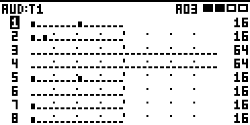
*The 8 audio tracks, 32 steps a row: AUD in the title.*

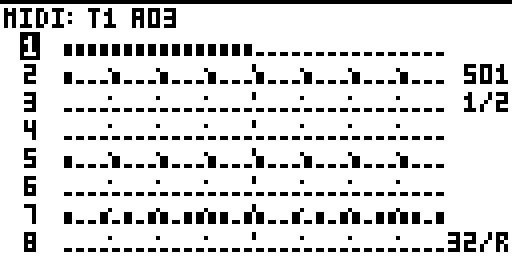
*The 8 MIDI tracks, 32 steps a row (the default).*

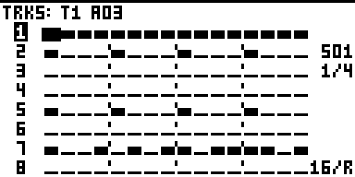
*16 steps a row: press encoder D.*


*Playing: the play position is marked on every track.*

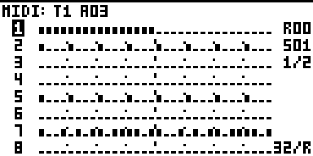
*Arranger on: the arrangement row (R00) at the top right. While playing, the title also counts down the
bars to the next row.*

How to read it:

- **Tall bar** = a trig. **Short bar** = a trigless trig. **Line** = an empty step.
- **Blank** = past the end of that track (tracks can be different lengths).
- A track shorter than the row repeats to fill it, so a 16-step track shows twice at 32 a row.
- The track number at the left is **inverted** for the active track and flashes **M** when the track
  is muted.
- At the right: the cursor's step (S01) and which part of the pattern you're looking at (1/2). The
  zoom is at the bottom (32/R = 32 steps a row).

**Whole tracks.** Press LEFT on step 1 and the cursor moves onto the track number, which flashes.
There, **FUNC + REC** copies the whole track (all 64 steps, their locks, the length and scale),
**FUNC + STOP** pastes it onto the track you're on, and **FUNC + PLAY** clears all its steps.
**UP / DOWN** move between track numbers, and **RIGHT** goes back to step 1. **FUNC + NO** undoes. On
the audio side, CLEAR only.

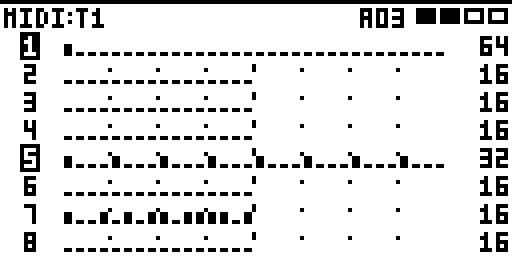
*The cursor on track 1's number (it flashes), ready to copy, clear or paste the whole track.*

### 2. Pages: one track, all 64 steps

The cursor's track, its four pages stacked. Use it to see a whole long track at once.

**Audio tracks: the step's p-locks underneath.** With the arranger off, the top half shows the track's
steps and the bottom half the cursor step's p-locks, in the [lock window's](#the-lock-window) five
columns.

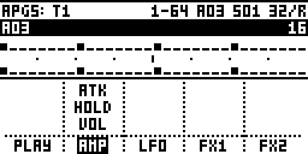
*Audio track 1, step 1: ATK, HOLD and VOL locked on AMP. AMP is inverted at the bottom: that's the page
the knobs are on.*

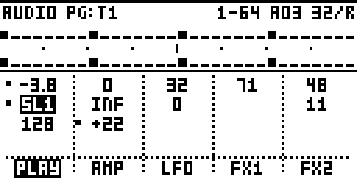
*Hold FUNC: the same locks, by value.*

- Each column shows three locks. When there are more, the third line says how many more (**+2**), and
  YES opens the lock window with all of them.
- The **page keys** (PLAYBACK, AMP, LFO, FX1, FX2) pick which column the knobs work on; its name is
  inverted.
- **Knobs A-F** lock that page's six parameters on the cursor's step, starting from the Part's value.
  With a trig held, they lock that trig's step instead, as usual. FUNC + a knob does nothing.
- Leave the view with NO or MIXER + MIDI.

**MIDI tracks** (and audio with the arranger on) use the whole screen for the steps:

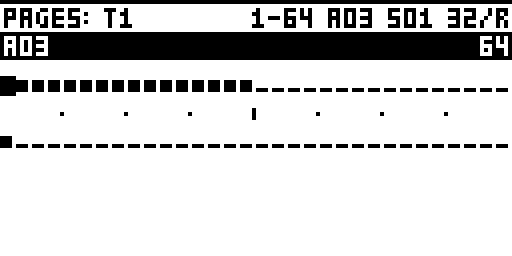
*32 steps a row: two pages per row.*

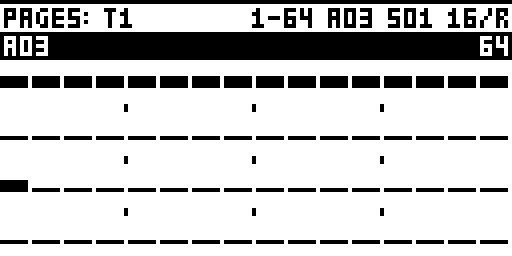
*16 steps a row: one page per row. Press encoder D to switch.*

- The bar under the title shows the pattern (A03) and the track's length (64).
- **Knob D** changes the spacing between the rows (10 to start).

**Arranger on: the timeline.** Pages becomes your arrangement, laid out in the order it plays, one page
per row, for the cursor's track.

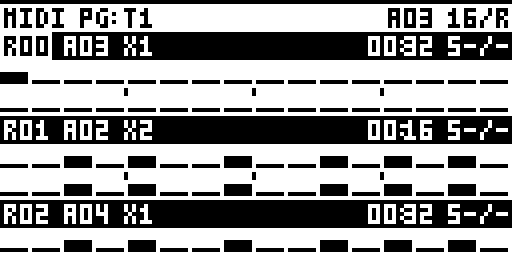
*Three arrangement rows at once, 16 steps a row: A01 twice, A02 once, A03 twice. Every row's steps for
the cursor's track, in the order they'll play, without opening a single pattern.*

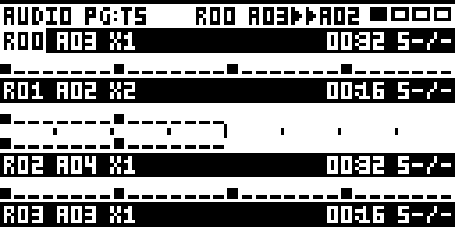
*The inverted line is an arrangement row's settings: R00 (row 0), A03 (its pattern), X2 (played twice),
00:00 (offset and length; 0 = the pattern's length), S-/- (no scenes). Under it, that row's pages.*

Each arrangement row starts with a line of its settings: row number, pattern, repetitions, offset and
length, scenes, mute. You can change them right there: **LEFT / RIGHT** pick one, **LEVEL** changes it.
A countdown shows the bars left before the next row.

### 3. Pitch: a piano roll (MIDI)

The cursor's MIDI track as notes on a keyboard, for writing melodies and bass lines. **Press encoder D**
to switch between three layouts. They all show the same notes and keep the same range. The arranger
doesn't change this view.


*ROLL 16: one page of 16 steps, a keyboard on the left. Press encoder D for the next layout.*


*ROLL 32: two pages across two octaves.*


*KEYS 16: turned sideways, steps run down the screen over a keyboard, like a player piano's roll
feeding into the keys.*

How to read it:

- **Squares** are notes, and the box is the cursor.
- A small arrow means a note that's **above or below** what's on screen. It sits on the row with the
  same letter, or on the top or bottom row when that letter has no row on screen.
- Dotted rows are the sharps.
- The title shows the cursor's note and step (C3 S01), the pattern, and which of the four pages you're on.

Moving around:

- **Up and down in pitch**: the arrows along the keyboard, or **knob A** (in ROLL 32: **LEVEL**). Go
  past the edge and the range scrolls.
- **FUNC +** those moves by an octave.
- **Along the steps**: the other two arrows, or **LEVEL** (in ROLL 32: **knob A**).
- **To another page**: FUNC + those arrows, or the **SCALE / PAGE** key.
- **To the lowest / highest note on the page** (ROLL 16): press **encoder A / C**.

**The trig keys become a keyboard** in this view:

- The 16 trig keys play 16 notes in a row, starting from C.
- Press one to hear it. **FUNC + a trig key** writes that note into the cursor's step.
- **Knob E** slides the keyboard up and down a semitone, and **FUNC + knob E** an octave.
- **PATTERN + trig** and **BANK + trig** still pick patterns and banks as usual.

### 4. Split: the numbers, for the arranger

The screen split in two: the grid on the right, and on the left a column with the cursor's step, the
pattern cues (the pattern playing and the one coming, beside the grid) and the play clock at the bottom.
It was designed as the arranger's companion, and follows it: turn the arranger on or off and Split
switches with it.

- **Arranger off**: the 8 tracks.
- **Arranger on**: the timeline, plus the arrangement controls. You can see and change the row
  playing and the pattern of this row and the next, and mute the row. Each pattern's cue sits on the
  left at the row where it starts. Save the arrangement from the ARR menu.

**Audio tracks.** The left column shows the step's trig: TRIG, TRIGLESS or NO TRIG. YES opens its lock
window.

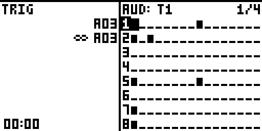
*Audio track 1, step 1: a trig. A03 is playing and repeats (∞).*

**MIDI tracks.** The left column shows the step's four notes (names over octaves), its velocity and
length.


*Step 1: its four notes (C, C#, G, F#, in octaves 3, 5, 3, 4), V 96, L 127 INF.*

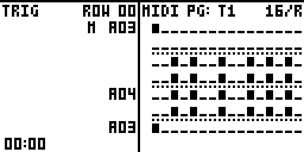
*Playing an arrangement: ROW 00 is the row playing. M ▶A03 is this row's mute and pattern; 2 A02 is
the next row's pattern (2 = its repeats), and A04 and A03 further down mark where those rows start.*

On the MIDI side, **YES** puts the cursor in the values column: **UP / DOWN** pick a line, **LEFT /
RIGHT** a value, and **LEVEL** changes it (as a parameter lock on that step). DOWN past LEN moves the
cursor onto the track's name in the grid's title. Press **YES twice quickly** for the step's lock
window. **NO** goes back to the grid.

**Zoomed timeline.** With the arranger on, press **encoder D** to show 4, 8 or 16 steps a row. **UP /
DOWN** move one row at a time.

---

## The lock window

Every p-lock on a step, on one screen. Open it with **YES** on a step:

- **Audio tracks**: YES on a step with a trig or p-locks, in any view. YES on an empty step just puts a
  trig there.
- **MIDI tracks**: YES in Tracks or Pages, or YES twice quickly in Split. An empty step gets a note
  first.

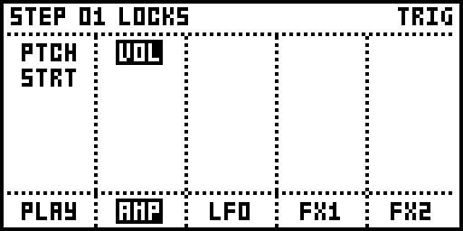
*Audio track 1, step 1: PTCH and STRT locked on the playback page, VOL on AMP. VOL is picked.*

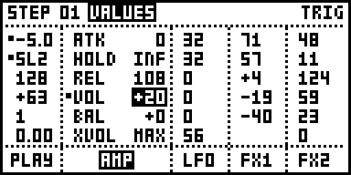
*Hold FUNC: the same locks, by value.*

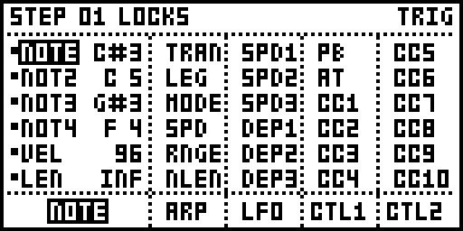
*MIDI track 1, step 1: its NOTE page locks (the four notes, VEL and LEN). NOT3 is picked.*

There's one column for each page key, in the order the keys sit under the screen:

| | Key 1 | Key 2 | Key 3 | Key 4 | Key 5 |
|---|---|---|---|---|---|
| **Audio tracks** | PLAY (SRC on the MKII) | AMP | LFO | FX1 | FX2 |
| **MIDI tracks** | NOTE | ARP | LFO | CTL1 | CTL2 |

Each column lists only the parameters locked on that step, by their full names. A page has six
parameters, so a column never overflows, and a name that appears on two pages (VOL on AMP and on a delay)
always sits under its own page. On a MIDI step written in STEP VIEW, the NOTE column always lists all
six: STEP VIEW locks the notes, VEL and LEN to each step.

| Action | Result |
|---|---|
| A **page key**, or **LEFT / RIGHT** | Pick a column. |
| **UP / DOWN** | Pick a lock in the column. |
| **LEVEL** | Change the picked lock. |
| **Knobs A-F** | Lock that page's six parameters, as holding a trig does. A new lock starts from the Part's value. (Not on ARP: the Octatrack doesn't lock its ARP page.) |
| Press a **knob** | Remove that parameter's lock. |
| Hold **FUNC** | See the values instead of the names. |
| **YES** | Switch the step between TRIG and TRIGLESS. Its locks stay. |
| **NO** | Close the window. |

The same columns, three lines tall, are the bottom half of [audio Pages](#2-pages-one-track-all-64-steps).

---

## Encoder D: press it to change how the view looks

Press **encoder D** in any view to change how it's shown. In Pages, turning D sets the row spacing (10 to
start; not in audio Pages, where the knobs lock values).

While STEP VIEW is open, a knob it doesn't use does nothing, turned or pressed. The page under the view
(AMP on the audio side, the ARP page on MIDI) can't be changed unseen. With a trig key held, the knobs
lock values on that step as usual.

| View | Press D |
|---|---|
| **Tracks** | Zoom: 16 ↔ 32 steps a row |
| **Pages** | Zoom: 16 ↔ 32 steps a row |
| **Pitch** | Next layout: ROLL 16 → ROLL 32 → KEYS 16 |
| **Split** (arranger on) | Zoom the timeline: 4 → 8 → 16 steps a row |

---

## Everything else

### Editing steps

- **Track keys** jump the cursor to that track. **UP / DOWN** in Tracks also make that track the
  active one.
- **SCALE / PAGE** jumps a page, as does **FUNC + LEFT / RIGHT**. **LEVEL** in the grid moves the cursor
  along the 64 steps.
- **Undo** goes back nine steps, for the whole pattern.
- **MIDI notes** have four voices (NOTE and NOT2–4), a velocity and a length. They're all locked to the
  step, so each step can be different.
- **Grid recording** (MIDI): hold a trig key for a moment to open that step's lock window. Turn
  **LEVEL** with the key held to change its note.

### Copy, clear, paste

In STEP VIEW, **FUNC + REC / PLAY / STOP** are **COPY / CLEAR / PASTE**:

- **FUNC + LEVEL** marks a run of steps from the cursor. COPY, CLEAR or PASTE then work on that run.
  PASTE repeats what you copied to fill the run.
- On a **track number** (Tracks): COPY, CLEAR and PASTE act on the whole track, length and scale
  included. On the audio side, CLEAR only.
- With nothing marked: **COPY** copies the cursor's step, **CLEAR** clears it, and **PASTE** puts the
  copy at the cursor.
- **Copying between audio and MIDI tracks** (grid recording's FUNC + REC / FUNC + STOP) converts
  between them. An audio track's pitch becomes notes, and an OCTA-303 line keeps its accents and
  slides.

### Track names (MIDI)

Each MIDI track can have a 12-character name, per Part and bank. It shows in the grid's title in place
of T1-T8. To set it, press YES in Split and move down past LEN onto the name. Hold **FUNC** for a
keyboard of characters. Names are saved with the project.

---

## Settings (BRAIN > SETTINGS > STEP VIEW)

octabam keeps module settings in its **BRAIN** menu. STEP VIEW's are **project settings**: each
project saves its own copy when you SAVE PROJECT and gets it back when you load it. STEP VIEW writes
them itself as you use it, so you never need to touch them. They're there so a project opens the way
you left it, and so you can see or reset them.

| Setting | What it means |
|---|---|
| **FULL** | Which kind of view you were in: 1 = Tracks, Pages or Pitch; 0 = Split. |
| **PAGES** | 0 = Tracks, 1 = Pages. (The Split view ignores this and follows the arranger.) |
| **PITCH** | 1 = you were in the Pitch view. |
| **LAYOUT** | The Pitch layout: ROLL 16, ROLL 32 or KEYS 16. |
| **RANGE** | The lowest note the Pitch view shows (45 = A2). The view shows two octaves from here. |
| **ROW** | Where the Pitch cursor is, in semitones above RANGE. |
| **ROLL16 BASE** | ROLL 16 shows 11 of those notes at a time; this is which one is at the bottom. |
| **TRIG ROOT** | The lowest note of the trig-key keyboard. -1 = start from the C below the cursor. |
| **FULL ZOOM** | Steps per row in Tracks and Pages: 2 = 16, 3 = 32. |
| **ZOOM** | Steps per row in the Split view's timeline: 0 = 4, 1 = 8, 2 = 16. |

MIXER + MIDI always opens Tracks, Pages or Pitch, whichever you used last. The Split view is one press
of the combo further on.

---

## Why it works this way

These choices are the current answers, not final ones. Here's the thinking, so you can disagree with
it.

- **MIXER + MIDI to get in.** The Octatrack has no spare page key. STEP VIEW draws on top of the MIDI
  ARP page but only while it's open, so the arpeggiator stays fully usable. MIXER + MIDI works from
  any page and doesn't take a key away from anything.
- **The same combo to switch views.** One gesture to remember. The cost is that the Split view is
  four presses away.
- **MIDI alone for the other side.** It's the key that already switches the Octatrack between its audio
  and MIDI tracks, so in STEP VIEW it does the same thing.
- **NO to go back.** Everywhere else on the Octatrack NO means "back" or "cancel", so it does here
  too: it closes what's open, and from the grid it leaves.
- **FUNC + PLAY to clear.** That's the Octatrack's own CLEAR combo. Undo (FUNC + NO) is there if you
  clear the wrong thing.
- **Press D to change the view.** One action does the same kind of thing everywhere: zoom in Tracks,
  Pages and the timeline, the layout in Pitch.
- **The track number for whole-track actions.** The number is already the track's label, so putting
  the cursor on it means "this whole track", the same way the cursor on a step means "this step".
- **The lock window's columns follow the page keys.** The five keys under the screen already mean
  those five pages, so pressing one jumps to its column, and each column's name sits above its key.
  Only locked parameters are listed, so a column shows its names in full; FUNC, the Octatrack's
  "show me more" key, swaps them for values. Audio Pages uses the same columns, so the step's locks sit
  under its steps.
- **The Split view for the arranger.** The arranger is the part of the Octatrack that's hardest to
  see. The Split view puts the arrangement's timeline next to the numbers you need to edit it.
- **Nothing outside STEP VIEW changes**, apart from these:
  - **MIXER** opens its window when you let go, not when you press it, so that MIXER + MIDI can work.
  - **FUNC + BANK** twice with the arranger on opens the arrangement editor.
  - In the stock SCALE window (FUNC + SCALE / PAGE), **UP / DOWN** move between rows and **SCALE**
    opens ALL TRACK SCALES.
  - Copying a track in grid recording can convert between audio and MIDI tracks.

---

## Adding it to your build

You need octabam's build, which uses your own copy of the Octatrack OS (no Elektron code is in this
repo). STEP VIEW needs two other octabam modules: **BRAIN** (settings) and **STORE** (track names).

1. Copy `modules/step-view` into an octabam checkout's `modules/` folder.
2. Add `"STEP VIEW"` to your remix's `modules=(...)`, after `"BRAIN"` and `"STORE"`.
3. In `modules/store/manifest.py`, add this line to `CLIENTS`:
   ```python
   ("STEP VIEW", "sgn", ("loadall_pre", "loadmask_pre", "newproj", "bankw_post", "pstore_pre",
                         "pstore_post", "preload_post", "partclear")),
   ```
4. Run `make modules` to check it doesn't clash with your other modules, then
   `make bus REMIX=<yours>`.

If you also use octabam's TRIG MODES module, STEP VIEW keeps the active track's trig mode in step
with it.

| File | What it is |
|---|---|
| `modules/step-view/stepview.s` | The code (ColdFire assembly, runs from RAM). |
| `modules/step-view/manifest.py` | Tells octabam where it hooks in, and its settings. |
| `modules/step-view/brain.lock` | The settings' fixed IDs. |
| `modules/step-view/UI_RULES.md` | The layout rules the screens follow (centring, spacing). |
| `docs/screens/` | The screenshots on this page, from octabam's Octatrack emulator. |

**Status:** built and tested in octabam's emulator. Parts of it have run on its author's MKI, but not
every feature has been tested on hardware. The audio-track features (Split, audio Pages, the lock window)
are new and so far tested only in the emulator. Back up your card before flashing anything.

## Licence and credit

MIT (see `LICENSE`): use it, change it and share it, keeping the notice. Written by Slingdinger. It
builds inside [octabam](https://github.com/sambanks/octabam) by Sam Banks and contributors, which has
its own terms.
