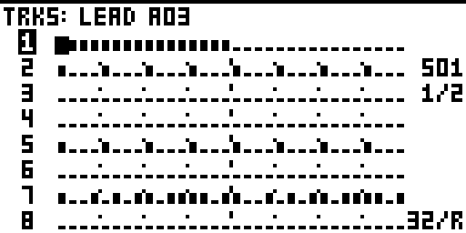
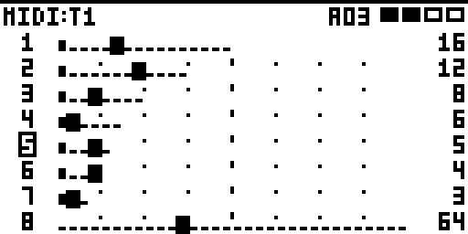
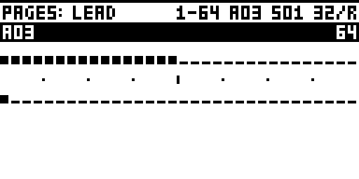
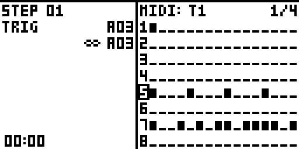
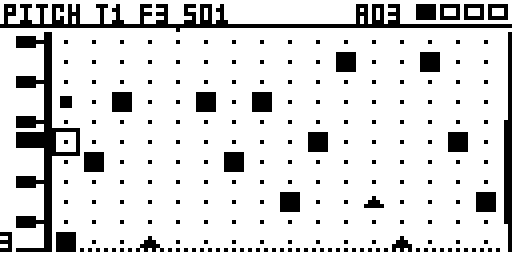
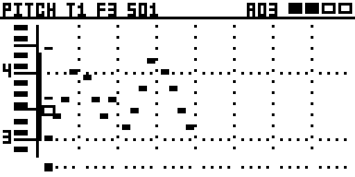
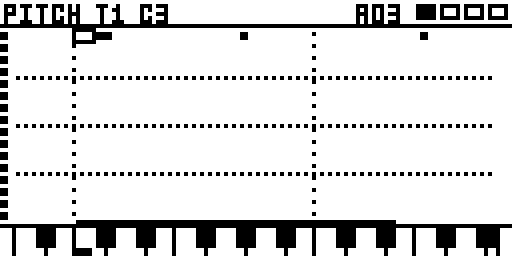
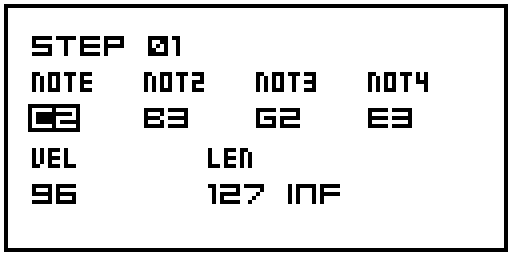
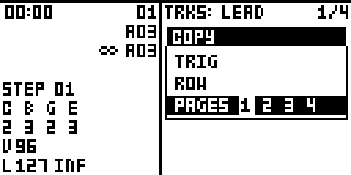

# STEP VIEW

A step editor and piano-roll pitch view for the Octatrack's 8 MIDI tracks. It is a module for
[octabam](https://github.com/sambanks/octabam), the Octatrack OS remixer, and runs on OS 1.40C (MKI and
MKII keymaps).

Hold **MIXER** and press **MIDI** from any page to open it. Press the combo again to switch
windows, and press any page key to leave.

| | |
|---|---|
|  |  |
| **Tracks**: all 8 MIDI tracks, 32 steps a row | **Tracks, playing**: the step playing marked on every track |
|  |  |
| **Pages**: one track's 64 steps | **Panel view**: the grid with the step's notes, VEL and LEN beside it |
|  |  |
| **Pitch, ROLL 16**: a piano roll of one page | **Pitch, ROLL 32**: two pages over two octaves |
|  |  |
| **Pitch, KEYS 16**: steps down the screen over a keyboard | **Step window**: one step's four notes, VEL and LEN |
|  | |
| **Copy window**: copy a trig, a row or chosen pages | |

The screenshots come from octabam's Octatrack emulator, with the screen scaled 4x.

## Features

### Opening and moving around

- **MIXER + MIDI** opens the view from any page, switching the Octatrack to MIDI mode if it was in
  audio mode.
- In the view, the same combo cycles the windows: **Tracks → Pages → Pitch**.
- **FUNC + ARP** switches between the full-screen grid and the **panel view** (the grid with a value
  panel on the left).
- **MIDI** alone switches between the 8 MIDI tracks and the 8 audio tracks (**AUDIO**). The audio
  tracks show their trigs and trigless trigs, and you can place and clear them.
- Any other page key leaves the view and puts back the page and the audio/MIDI mode you came from.
- The view, window, pitch layout, range and zoom are saved with the project (ten BRAIN PROJECT
  settings) and come back on load.

### Tracks and Pages windows

- **Tracks** shows all 8 tracks at once. **Pages** shows the cursor's track as its 4 pages of 16 steps.
- Each step is drawn as one of:
  - a full bar: a note trig
  - a half bar: a trigless trig
  - a line at the foot: no trig
  - blank: past the track's length
- In the panel view, each note's length is drawn as a line running from its trig. **YES** on LEN shows
  or hides the lines.
- Playing, the step each track plays is marked, and the window follows the page that is playing
  while you're hands off.
- A muted track's number flashes **M**, and its trigs flash. This counts pattern mutes, arrangement
  mutes and solo, worked out the way the MIDI engine does.
- The active track's number is inverted. **UP / DOWN** in Tracks also makes that track the active one.
- Tracks shorter than the row repeat across it, so a 16-step track fills a 32-step row.
- **Knob F** zooms (16 or 32 steps a row, or 4–16 in the panel view). **Knob E** scrolls.
- **Knob D** sets the row spacing in Pages.
- The title row shows the window, the track's name, the pattern, the steps in view, the cursor's
  step and the zoom.
- The 4-step dots and 16-step dividers stay centred at every zoom and spacing.

### Arranger timeline

- With the arranger on, Pages becomes a timeline: the arrangement's pages in the order they play,
  one per row. Each arrangement row starts with a readout line:
  - the row number
  - its pattern
  - repetitions
  - offset and length
  - scenes A / B
  - mute
- The readout fields are edited in place: **LEFT / RIGHT** pick a field, **LEVEL** changes it, and
  the arrangement is marked unsaved.
- **YES** on a readout line opens the arranger's editor at that row.
- A countdown shows the bars left before the next row starts, and the pattern to come flashes.
- You can edit steps of any pattern in the current bank straight from the timeline.
- **FUNC + BANK** twice with the arranger on opens the arrangement editor.

### Editing steps

- **LEFT / RIGHT** move along the steps and **UP / DOWN** between tracks or pages. Held arrows repeat
  quickly.
- **FUNC + LEFT / RIGHT** moves a page or a whole screen.
- **LEVEL** moves the cursor step by step.
- **SCALE / PAGE** (MKI / MKII) moves a page on.
- A **track key** moves the cursor to that track.
- **YES** puts a note trig on an empty step and opens the panel. A quick second **YES** opens the
  **step window** (big type).
- **NO** asks "CLEAR? YES" and clears the step on **YES**.
- In grid recording, holding a trig key for 400 ms opens that step with NOTE picked. **LEVEL** with the
  key held changes the note.
- **FUNC + NO / FUNC + YES**: undo / redo for the whole pattern, ten states deep. It covers trigs,
  locks, panel edits, clears and pastes, and shows "UNDO 3/9" or "NO UNDO".

### The panel

- **Header**: the play clock (mm:ss), the step count, the pattern playing and the pattern to come.
  The pattern to come has a countdown in bars, or ∞ when nothing is queued.
- **Track name**: 12 characters per MIDI track, per Part, per bank. Hold **FUNC** on a name
  character for a character keyboard. The names are saved in `names.work` with the project, and
  Part Clear empties that Part's names.
- **STEP**: the cursor's step.
- **Notes**: NOTE and NOT2–4 with their octaves, where a dash means off.
- **VEL** and **LEN**. LEN shows its value and its note fraction (1/32 … 5/4, INF).
- **Moving and editing**:
  - **UP / DOWN** pick a line and **LEFT / RIGHT** a value.
  - **LEVEL** changes the value as a parameter lock on that step.
  - **FUNC + UP / DOWN** moves a note an octave.
  - **NO** goes back to the grid.
- **LEN**: **LEVEL** steps through the note fractions, and **FUNC + LEVEL** moves the value by one. A
  value between two fractions is marked ("-5/8" or "5/8+").
- **Arranging**: the arrangement row and its patterns become values you can change. **YES** on
  **M** opens the row's MUTE window. A **SAVE** button appears when the arrangement has unsaved
  changes.

### Copy, clear and paste

- In the view, **FUNC + REC / PLAY / STOP** become **COPY / CLEAR / PASTE**.
- **FUNC + LEVEL** marks a run of steps from the cursor. COPY, CLEAR and PASTE then act on the run,
  and PASTE repeats the clip to fill it.
- With no run marked, COPY and CLEAR open a window: **TRIG** (one step), **ROW** (the cursor's
  page), or **PAGES** with each of the 4 pages on or off.
- A step carries its trig, trigless and swing bits, its 32 locks and its trig word (micro timing and
  condition).
- **Converting between audio and MIDI tracks** (grid recording **FUNC + REC / FUNC + STOP**, or the
  view's PASTE):
  - **Audio → MIDI**: the pitch becomes NOTE.
  - **MIDI → audio**: the masks, trig words, LEN and SCALE carry over.
  - **From an OCTA-303 track**: TUNE becomes NOTE, ACC becomes velocity 101–127, and a slide becomes a
    held note.

### Pitch view

- A piano roll of the cursor's track with three layouts. Press **encoder F** to step through them:
  - **ROLL 16**: 16 steps across 11 rows, with a keyboard on the left and a scroll bar on the right.
  - **ROLL 32**: 32 steps over 24 notes, with octave numbers and a step row at the foot.
  - **KEYS 16**: 16 steps down the screen over a 24-key keyboard.
- NOTE is a solid block, NOT2–4 are smaller blocks, and a trigless step is an outline. A note in
  another octave is an arrow pointing to it. Sharps' rows are dotted. The cursor is an outline round
  its cell.
- The range can start on any note from 0 to 104. Moving the cursor past its edge scrolls the range a
  semitone. The FUNC versions move it an octave.
- **Pitch** (one semitone): **UP / DOWN** in the rolls, **LEFT / RIGHT** in KEYS, or **knob A**.
- **Steps**: the other pair of arrows, or **LEVEL**.
- **Pages**: **FUNC +** that pair, or **SCALE / PAGE**.
- **Knob D** scrolls a semitone. **Encoder A / C** pressed jumps to the lowest / highest note on the
  page.
- **YES** on an empty step puts the cursor's note there. On a step with a trig, **YES** opens its step
  window, where **LEVEL** and the arrows edit it.
- **Trig keys are a 16-note chromatic keyboard**:
  - A press plays the note on the track, with the track's transpose applied.
  - **FUNC + trig** writes the note to the cursor's step.
  - **Knob E** moves the keyboard a semitone, and **FUNC + knob E** an octave. Its notes are marked in
    every layout.
  - Their LEDs light the keyboard's naturals. Playing, they also show the cursor step's note and the
    note playing.
  - **PATTERN / BANK + trig** still select a pattern or bank as usual.
- The title shows the cursor's note and step, the pattern and four page boxes. ROLL 32 blinks the
  page that is playing.

### Pattern length and scale

- **FUNC + SCALE / PAGE** opens the stock SCALE window (everywhere, not only in the view). In it, **UP / DOWN** move between rows
  instead of changing values, and **SCALE** opens **ALL TRACK SCALES**. In AUDIO, ALL TRACK SCALES
  sets the audio tracks.

### Other changes it makes

These apply outside the view as well:

- **MIXER** opens or closes the mixer window when you let go, not when you press it, so that
  MIXER + MIDI works.
- **FUNC + ARP** is the stock's (ARP SETUP) everywhere except in the view.
- **FUNC + BANK** twice with the arranger on opens the arrangement editor.
- In the stock SCALE window, **UP / DOWN** move between rows, and **SCALE** opens ALL TRACK SCALES.
- Grid recording's track copy / paste (**FUNC + REC / FUNC + STOP**) converts between audio and MIDI
  tracks, as described above.
- The MIDI ARP page, ARP SETUP and the arpeggiator are untouched when the view is closed.

## Using it in your build

You need octabam's build. It supplies the Octatrack OS 1.40C from your own copy, so no Elektron code
is in this repo. STEP VIEW also requires two octabam modules: **BRAIN** (settings) and **STORE**
(track names).

1. Copy `modules/step-view` into an octabam checkout's `modules/`.
2. Add `"STEP VIEW"` to your remix's `modules=(...)`, after `"BRAIN"` and `"STORE"`.
3. In `modules/store/manifest.py`, add this to `CLIENTS`:
   ```python
   ("STEP VIEW", "sgn", ("loadall_pre", "loadmask_pre", "newproj", "bankw_post", "pstore_pre",
                         "pstore_post", "preload_post", "partclear")),
   ```
4. Run `make modules` to check for conflicts with your other modules, then `make bus REMIX=<yours>`.

Optional: with octabam's TRIG MODES module, the view keeps the active track's trig mode in step.

### Files

| File | What it is |
|---|---|
| `modules/step-view/stepview.s` | The module (GNU as, ColdFire). It runs from DRAM. |
| `modules/step-view/manifest.py` | The octabam manifest: hooks, key handlers, settings. |
| `modules/step-view/brain.lock` | The BRAIN settings lock. |
| `modules/step-view/UI_RULES.md` | The layout rules the screens follow (centring, spacing). |
| `docs/screens/` | The screenshots above. |

### Status

Built and tested in octabam's emulator. Parts of it have run on its author's MKI, but not every
feature has been tested on hardware. Back up your card before flashing anything.

## Licence and credit

MIT (see `LICENSE`): use it, change it and ship it, keeping the notice. Written by Slingdinger. It
builds inside [octabam](https://github.com/sambanks/octabam) by Sam Banks and contributors, which has
its own terms.
